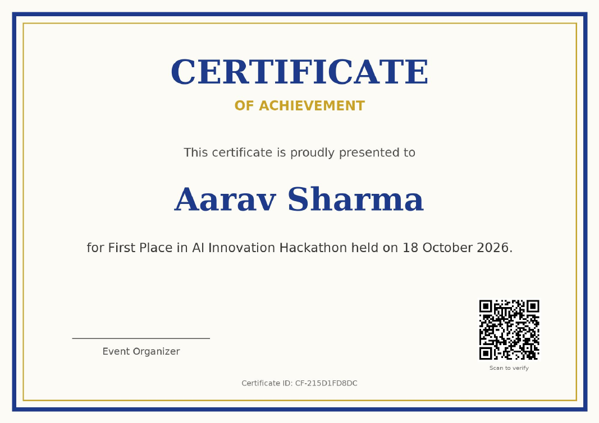

# 🏅 Laureo

**Upload once. Generate automatically. Deliver accurately.**

Laureo turns a spreadsheet of participants into personalised, verifiable certificates and emails each one to the right person. It works the same on Windows, Mac and Linux.



## Why Laureo

Event organisers still make certificates by hand: copy a name, paste it into a template, export a PDF, attach it to an email, repeat 200 times. Names get misspelled, people get the wrong file, and nobody can tell a real certificate from a fake one. Laureo does the whole job in five guided steps and catches the mistakes before they reach anyone.

## Features

- **Smart data import**: reads Excel or CSV and matches your columns automatically, even when they're named differently.
- **Catches mistakes first**: flags missing names, invalid emails and duplicate entries before anything is generated, with a downloadable problem report.
- **Your design or ours**: use the built-in template or upload your own PNG/JPG background.
- **QR verification**: every certificate has a unique ID and QR code. Scanning it opens a page that confirms the certificate is genuine.
- **Personalised email delivery**: sends each certificate to its owner over SMTP (Gmail works out of the box).
- **Live tracking**: see who got theirs, who failed, and retry failures in one click.
- **No accidental resends**: anyone already sent a certificate is skipped unless you choose otherwise.
- **Download everything**: all certificates as one ZIP, plus a delivery report as CSV.
- **Organiser login**: an optional password keeps the dashboard private.
- **Light and dark mode**: follows your computer's setting.

## How it works

1. **Upload data**: drop in the participant spreadsheet.
2. **Map & validate**: confirm the columns and fix flagged problems.
3. **Design certificate**: pick a template and layout.
4. **Preview & generate**: check a sample, then create every certificate.
5. **Send & track**: email them out and watch delivery status live.

## Run it

You need Python 3.10 or newer.

```bash
python -m venv venv
# Windows:      venv\Scripts\activate
# Mac / Linux:  source venv/bin/activate
pip install -r requirements.txt
cp .streamlit/secrets.toml.example .streamlit/secrets.toml   # then edit it
streamlit run app.py
```

The app opens at http://localhost:8501 in any browser.

**Want to try it without real data?** Run `python make_sample_data.py` to build a demo spreadsheet with deliberate mistakes, and watch Laureo catch them.

### Email setup

Edit `.streamlit/secrets.toml`. For Gmail, turn on 2-Step Verification and create an App Password (Google Account → Security → 2-Step Verification → App passwords). Never commit `secrets.toml`; it's already in `.gitignore`.

## Built with

Python · Streamlit · pandas · Pillow · qrcode · SQLite

## Project map

| File | What it does |
|---|---|
| `app.py` | 5-step wizard interface |
| `modules/validator.py` | Reads Excel/CSV, smart column mapping, validation, duplicate detection |
| `modules/certificate.py` | Draws certificates, QR codes, PDFs and file names |
| `modules/mailer.py` | Personalised emails over SMTP |
| `modules/db.py` | SQLite status tracking, retries, resend guard |
| `make_sample_data.py` | Builds demo data with planted mistakes |
| `sample_output/` | Example certificates Laureo generated |

## Team

Built for the IEEE Hackathon by Aashish, Aditya and Hormis.
